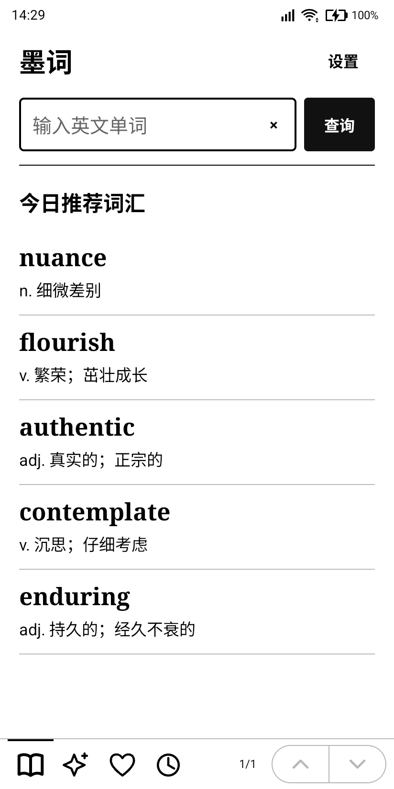
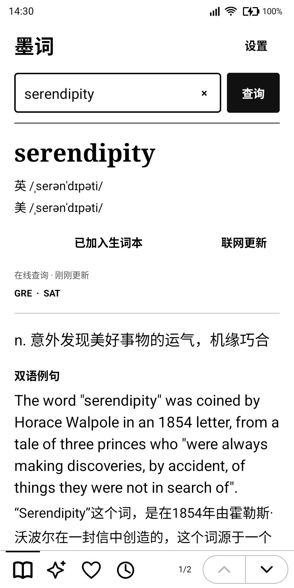
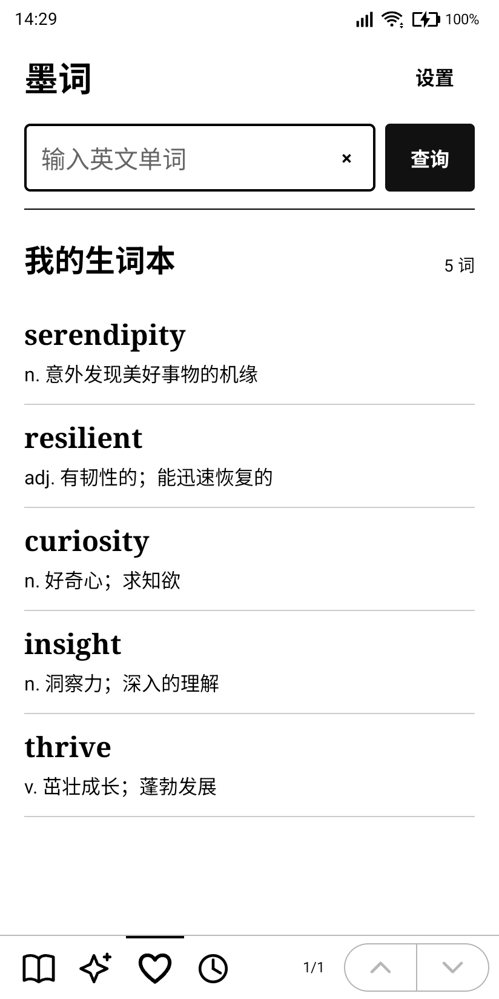

# 墨词 · MoCi

面向墨水屏的 Android 英汉查词应用，支持在线词典与自定义 OpenAI 兼容模型。

## 界面展示

墨词 1.2.8 在 iFlytek Fika（Android 16）上的实机截图。AI 查词和生词本页面使用演示内容，不含个人配置或查询记录。

| 今日推荐 | 词典查询 |
| :---: | :---: |
|  |  |

| AI 查词 | 生词本 |
| :---: | :---: |
|  |  |

## 功能

- 黑白界面、大字号、搜索框边框，精简说明文案。
- 词典首页每日推荐 5 个单词，附简短中文释义，点击即可查词。推荐来自内置词表，按设备日期轮换，同一天保持不变。
- 在线英汉释义、音标、词形变化及双语例句；已查词条可从本机缓存打开。
- AI 查词支持自定义 HTTPS 接口、模型和 API Key，提供释义、用法、例句、助记及易混词。
- 生词本、最近 80 条查询历史、三档字号、文字选择和分享查词。
- 词典结果、AI 查词、生词本和历史均支持右下角 ↑ / ↓ 按钮及页码。
- 音量上键上一页、音量下键下一页；每次按下翻一页，长按不连翻，首尾不越界。
- 翻页瞬间切换，保留少量上下文重叠；未调用设备专有的墨水屏刷新接口。

## 安装

从 [Releases](../../releases) 下载 APK，最低 Android 8.0（API 26），目标 Android 16（API 36）。已在 iFlytek Fika（Android 16、824 × 1648）验证。

当前 APK 使用开发签名。源码不包含私钥；自行构建默认生成新签名，无法直接覆盖其他签名的安装。卸载会清除本机应用数据。

## AI 配置

应用右上角「设置 → AI 服务设置」，填写 HTTPS 服务地址、模型 ID 和 API Key。地址可为基础地址或完整的 `/chat/completions` 地址；需要 `/v1` 的服务请在地址中包含该路径。

应用不内置服务账号或 API 密钥。只在手动查询或重新生成时请求模型，费用由配置的服务商按账号收取。AI 回答可能不准确。

## 数据与隐私

词典使用有道网页查询接口 `https://dict.youdao.com/jsonapi`，并在词条底部标明来源。该接口并非正式开放平台 API，可能变更、限流或停用。未缓存的单词需要联网。

AI 查询向所配置的服务发送查询内容和提示词。API Key 使用 Android Keystore 的 AES-GCM 加密保存在本机，不写入日志或源码，配置不参与系统备份。HTTPS 证书正常校验，不跟随重定向传递密钥。

缓存、生词本与历史保存在应用私有目录。AI 缓存按地址、模型和单词隔离。应用仅申请 INTERNET 权限，无广告、分析 SDK、无障碍或通知访问权限。

## 构建

使用 Android SDK 工具直接构建，无 Gradle 或第三方库依赖。

需要 JDK 17+、Build Tools 36.0.0 和 Android SDK 平台 `android-37.0`。可通过 `ANDROID_HOME`、`JAVA_HOME`、`BUILD_TOOLS_VERSION`、`MOCI_PLATFORM` 覆盖本机路径或版本。

```sh
bash build.sh
```

输出：`dist/moci-1.2.8.apk`。

默认在 `.build/` 生成开发签名；也可用 `MOCI_KEYSTORE` 指定自己的密钥库。脚本面向本地开发，默认密码为 `android`，正式发布应独立管理签名与密码。不要将私钥或真实服务密钥提交到仓库。

## 1.2.8

底栏图标略微放大，导航入口及上下翻页按钮间距加宽。

## 1.2.7

底栏统一为左侧图标导航、当前页顶部短线、右侧页码及胶囊形上下箭头。保留音量键翻页。

## 1.2.6

补齐 AI 查词、生词本和历史页的固定翻页栏与音量键支持。保留每日推荐、搜索框边框、词典查询和模型配置。
